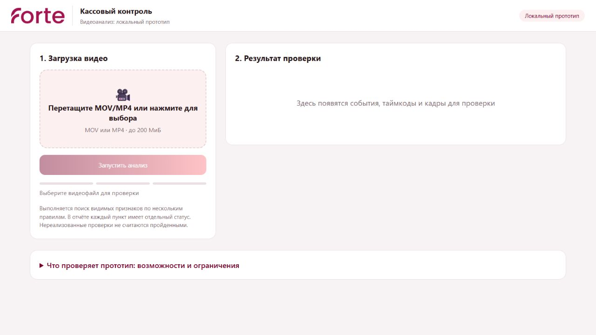

# Forte Cash Audit
### Локальный анализ видео кассовых операций

[Инструкция для жюри](docs/JURY_GUIDE.md) · [Проверки и тесты](docs/TESTING.md) · [Контракт API](docs/API.md) · [Изменения](CHANGELOG.md) · [Результаты пилота](docs/PILOT.md) · [План развития](PLAN.md)

**Выпуск v0.2.0 · исследовательский прототип.** Интерфейс соединён с реальным локальным анализатором: загрузка видео, ожидание и результат доступны на одной веб-странице.

> Для проверки откройте **http://127.0.0.1:8000/** после запуска сервера. Подключены **16 экспериментальных визуальных проверок** и отчёт по **33 пунктам**. Для **17 пунктов детектор не реализован**: они требуют ручной проверки. Это не полный автоматический контроль всех требований банка. [Точное покрытие](docs/RULE_COVERAGE.md).

## Что получает проверяющий

- Загрузка своего MOV/MP4 → результат на странице; JSON также доступен через API.
- Начало события и момент подтверждения условия.
- Настоящие кадры исходного видео с таймкодами.
- Текст наблюдения и признак обязательной ручной проверки.
- Обработка на собственном компьютере; облачных API анализа нет.

| Возможность | Статус |
| --- | --- |
| Кандидат «банкноты остались, кассир отходит к выходу» | Включён; настроен для известной сцены |
| Приём видео, очередь, выдача результата через FastAPI | Реализовано |
| Фронтенд со справочником / без справочника | Оба подключены к настоящему анализатору |
| Банкноты при повторном появлении посетителя; открытый сейф | Экспериментальный поиск включён; возможны пропуски |
| Уход при посетителе, одежда, телефон, дверь, затемнение камеры, еда/чашка | Экспериментальные визуальные кандидаты, не доказанные нарушения |
| Оставленный ключ и активный экран после ухода | Узкие экспериментальные проверки включены; поворот ключа и состояние ОС не устанавливаются |
| Удостоверение, подлинность, пересчёт и другие нереализованные действия | Отмечаются как непроверенные, не как успешно пройденные |
| Неизвестные ракурсы и типы нарушений | Не подтверждено |

## Жюри: запуск без установки Python и библиотек

**Скачайте готовый Windows-пакет из [Releases](https://github.com/hikkki013/forte-cash-audit/releases/tag/v0.2.0), а не `Source code (zip)`.** Исходный код и готовое приложение — разные файлы. Репозиторий приватный: владелец должен заранее предоставить жюри доступ.

### Требования к компьютеру

- Windows 10/11 x64 и обычный браузер. Другие ОС этой сборкой не поддерживаются.
- Рекомендуется NVIDIA GPU с 6 ГБ памяти и совместимым установленным драйвером CUDA 12.8; проверено на RTX 4050 Laptop 6 ГБ. Работа на 4 ГБ не подтверждена.
- Рекомендуется 16 ГБ оперативной памяти и не менее 15 ГБ свободного места для архива, распаковки и временных видео.
- Без NVIDIA возможен CPU-режим, но проверка может не уложиться в лимит времени. Драйвер видеокарты — системное требование, он не входит в пакет.

**Не нужны отдельная установка Python, Git, Node.js, Docker, FFmpeg или CUDA Toolkit и скачивание модели.** Интерпретатор, зависимости и веса входят в готовый пакет. Интернет нужен для получения архива; сам анализ работает офлайн.

### Пошагово

1. В разделе Releases скачайте `Forte-Windows-v0.2.0.zip`.
2. Нажмите правой кнопкой → **«Извлечь всё»**. Выберите короткий доступный для записи путь, например `C:\Forte`. Не запускайте приложение внутри ZIP и не помещайте его в Program Files.
3. Откройте распакованную папку и дважды нажмите **`Check-Forte.cmd`**. Дождитесь `CHECK OK`: проверяются встроенный Python, CUDA, веса и реальный запуск модели. При ошибке сохраните текст окна.
4. Дважды нажмите **`Start-Forte.cmd`**. Окно сервера должно оставаться открытым. Браузер откроется автоматически; если нет — откройте **http://127.0.0.1:8000/**.
5. Выберите **своё MOV/MP4 до 200 МиБ**, нажмите **«Запустить анализ»** и дождитесь результата.
6. Проверьте тип события, таймкод, реальные кадры, правило и источник. В списке **«Статус каждого правила — включая непроверенные»** посмотрите, какие проверки не выполнены.
7. Нажмите **«Проверить другое видео»** и повторите для следующих файлов. Для остановки нажмите **Ctrl+C** в окне сервера.

Не отключайте защиту Windows ради запуска. Если политика организации блокирует CMD/EXE, согласуйте запуск с её администратором. Прав администратора для обычного запуска не требуется.

### Проверки для жюри

- **`Check-Forte.cmd`** — окружение и один реальный запуск модели без скачивания.
- **`Test-Forte.cmd`** — автоматические Python-тесты из встроенного окружения; отдельно устанавливать Python не нужно. Эти тесты проверяют код, но не измеряют точность на ваших видео.
- Свои положительные и отрицательные ролики — проверка качества распознавания. Переименовывайте файлы, меняйте порядок; имена не используются для ответа.
- Если анализ завершился ошибкой, это **не** означает «нарушений нет». Часть правил не реализована и явно отмечена.
- Сохраните версию из `BUILD.json`, параметры компьютера, имя тестового файла, время обработки и ожидаемый/полученный результат. Сведения о компонентах — `DEPENDENCIES.json`.

[Подробная инструкция и протокол проверки](docs/JURY_GUIDE.md) · [Ограничения переносимой сборки](docs/PORTABLE.md)

### Почему localhost, а не внешний сайт?

`127.0.0.1` — адрес компьютера самого проверяющего. Приложение запускает локальный веб-сервер, видео остаются на его компьютере. Внешний хостинг потребовал бы удалённого вычислительного сервера и отправки видео туда; это другая схема, не полностью локальная обработка. GitHub Pages не запускает Python/GPU-анализатор.

## Разработчикам: запуск из исходников

Этот раздел не нужен жюри с готовым пакетом.

```powershell
git clone https://github.com/hikkki013/forte-cash-audit.git
cd forte-cash-audit
$python312 = py -3.12 -c "import sys; print(sys.executable)"
powershell -ExecutionPolicy Bypass -File .\scripts\setup.ps1 -Python $python312
.\Start-Forte.cmd
```

Для сборки из исходников нужны Python 3.12 и интернет на этапе установки. `setup.ps1` создаёт `.venv`, устанавливает зависимости и фиксированную ревизию модели. Node.js 22+ нужен только разработчику для тестов фронтенда. Видео, секреты и веса не хранятся в Git; веса входят только в отдельный готовый выпуск.

```powershell
powershell -ExecutionPolicy Bypass -File .\scripts\test.ps1
```

Автоматические тесты и результаты разработки описаны в [TESTING.md](docs/TESTING.md), [ADDITIONAL_CASES.md](docs/ADDITIONAL_CASES.md) и [KEY_DETECTOR.md](docs/KEY_DETECTOR.md). Зелёные тесты не являются измерением качества распознавания.

Карточки показывают название, таймкод, кадры, пометку о перепроверке, правило, основание и источник. Подробные описания, условия применения и ограничения сохранены в API, `config/rules.json` и документации.

Для обновления готового пакета распакуйте новый выпуск в отдельную папку, остановите старый сервер и запустите новый. Для исходников используйте `git pull --ff-only` только после проверки своих изменений. Старые результаты сервера не сохраняются после его остановки.

## Как работает анализ

```text
Исходное видео
    → декодирование по реальным PTS, выбор кадра раз в секунду
    → Grounding DINO Tiny: люди, предметы и кандидаты состояний двери/шкафа
    → зоны стола, кассира и выхода
    → несколько временных правил + оценка качества изображения
    → события + таймкоды + реальные JPEG-кадры
    → статусы всех пунктов → FastAPI / JSON → веб-интерфейс
```

Модель используется предобученной, без дообучения. Лица не распознаются. Имя файла и таблица ответов не используются для принятия решения. Порог отсутствия кассира 3 секунды — инженерная настройка, а не цитата из закона.

Для другой камеры или расстановки нужно отдельно настроить `config/scene.json` и проверить качество. Само совпадение разрешения видео не означает совместимость сцены.

## Как читать результат

| Поле | Значение |
| --- | --- |
| `verdict: violation` | Сработало включённое правило; это кандидат для проверки |
| `verdict: no_violation` | Включённое правило не сработало; другие нарушения не исключены |
| `result.coverage_status: partial` | Часть проверок не выполнена; предупреждение дополняет бинарный вердикт, но не заменяет его |
| `rule_checks` | Отдельный статус и причина для каждого из 33 пунктов |
| `status: failed` | Анализ не завершён; это **не** отсутствие нарушений |
| `timecode_sec` | Начало наблюдаемого условия |
| `confirmed_at_sec` | Момент накопления условий правила |
| `review_required: true` | Требуется проверка человеком |
| `evidence_frames` | JPEG в base64 с таймкодами исходных кадров |

Ссылки на нормы в описаниях предварительные. Они не являются юридическим заключением или утверждённой квалификацией для финальной сдачи.

## Что показал первый пилот (до расширения правил)

| Проверка | Наблюдение |
| --- | --- |
| X-26, реальный запрос через API | Одно событие: начало 10 сек, подтверждение 13 сек |
| X-26, загрузка через веб-интерфейс | Одно событие на 10 сек, реальные кадры; обработка 11.2 сек |
| X-25, повторная загрузка через тот же интерфейс | Без события по включённому правилу; обработка 17.6 сек |
| X-26, обработка 20 выбранных кадров | Около 11.34 сек после загрузки модели |
| X-14, ролик длиной 142.53 сек | Обработан за 78.72 сек, без события |
| Память в этих запусках | Около 1394 МиБ allocated-памяти PyTorch на GPU 6 ГБ |

Это локальные замеры, **не гарантии скорости и не accuracy/F1**. Время загрузки весов и очередь не входят в приведённое время анализа. На X-15 сценарий пропущен; на X-24 есть сомнительная классификация предмета. Все оговорки и история настройки приведены в [отчёте пилота](docs/PILOT.md). Работа на физической карте 4 ГБ не проверена.

При расширении правил на X-26 найдены телефон и оставленные банкноты, на X-46 — чашка у кассира. Это повторная настройка на известных материалах, не независимый тест. Сейф и дверь остаются ненадёжными; подробные результаты и ошибки — в [отчёте расширения](docs/MULTIRULE_PILOT.md).

## Интерфейс

Сохранены оба присланных варианта, исходные стили, кнопки и отступы. Описания приведены к фактическим возможностям.

<p align="center"></p>

После запуска `Start-Forte.cmd` доступны два варианта: http://127.0.0.1:8000/ui/with-rules/ и http://127.0.0.1:8000/ui/simple/. Корневой адрес открывает первый. Отдельный статический сервер на 8765 не нужен и не поддерживает анализ.

**Не запускать `frontend/*/main.py` как анализатор:** это исходная заглушка, которая всегда возвращает отсутствие нарушений. [Подробнее о фронтенде](frontend/README.md).

## Структура проекта

```text
forte/              локальная модель, правила, pipeline и FastAPI
config/             зоны сцены и каталог правил
scripts/            установка, запуск, тесты и исследовательские прогоны
tests/              Python-тесты и Node-проверки фронтенда
frontend/           два варианта интерфейса
docs/               инструкции для жюри, API, тестирование и отчёт пилота
colab/              ранний исследовательский baseline, не текущий анализатор
.github/workflows/  автоматическая проверка кода
Start-Forte.cmd     запуск локального веб-приложения после установки
```

`models/`, `runtime/`, `outputs/`, `.venv/` и исходные видео создаются/хранятся локально и исключены из Git.

## Границы применения и данные

- Анализ после установки работает локально. `start.ps1` включает offline-режим; модель загружается с `local_files_only=True`.
- Сервер слушает только `127.0.0.1`. Это демонстрационный сервис для доверенного пользователя, не публичная production-система.
- Бюджет 240 сек проверяется кооперативно; зависший вызов GPU не прерывается принудительно. Строгий предел 5 минут на любой файл не гарантирован.
- Результаты API находятся в памяти и теряются при перезапуске; сохраните нужный JSON заранее.
- Видео для оценки передаются жюри отдельно разрешённым способом. Кадры с людьми не публикуются в репозитории.
- Готовность полного конкурсного решения и соответствие всем требованиям конкурса **не заявляются**.

## Документация и лицензии

- [Пошаговая инструкция для жюри](docs/JURY_GUIDE.md)
- [Покрытие всех пунктов и причины неполной проверки](docs/RULE_COVERAGE.md)
- [Методика тестирования и команды](docs/TESTING.md)
- [Контракт API](docs/API.md)
- [Результаты и ошибки пилота](docs/PILOT.md)
- [Устранение проблем](docs/TROUBLESHOOTING.md)
- [Компоненты и права](THIRD_PARTY_NOTICES.md)
- [Правила работы команды](CONTRIBUTING.md)

Основные версии библиотек и ревизия модели зафиксированы, но полного lock-файла транзитивных зависимостей нет. Права на проект, материалы кейса и брендинг не заменяются лицензией модели.
